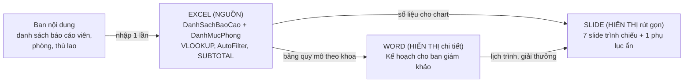

# Bộ hồ sơ kỹ thuật – Hội nghị Khoa học Sinh viên PTIT 2027

> **Lưu ý về dữ liệu:** đề không cho sẵn dữ liệu nên toàn bộ danh sách báo cáo viên, phòng, thù lao, lịch trình, giải thưởng, quy chế và ngày giờ (Thứ Bảy 22/05/2027) là **phần bổ sung do người làm bài tự đặt**, không phải dữ kiện gốc của đề.
> **Lưu ý về nộp bài:** phần "định dạng thư mục nộp" trong đề bị cắt cụt, nên tên thư mục dưới đây là tạm đặt. Cần hỏi lại giảng viên.

## Danh sách file

| File | Vai trò |
|---|---|
| `DanhSachBaoCao_PTIT2027.xlsx` | Nguồn dữ liệu (2 sheet: `DanhSachBaoCao`, `DanhMucPhong`) |
| `KeHoach_HoiNghi_PTIT2027.docx` | Tài liệu kế hoạch cho ban giám khảo |
| `SlideKhaiMac_PTIT2027.pptx` | Slide khai mạc (7 slide trình chiếu + 1 slide phụ lục ẩn = 8) |

---

## Phần 1 – Thiết kế kiến trúc

### 1.1. Sơ đồ luồng dữ liệu



| Thành phần | Loại | Giải thích |
|---|---|---|
| Excel | **Nguồn** | Chỗ duy nhất nhập và sửa số liệu. Sửa ở đây thì Word và Slide cập nhật theo. |
| Word | **Hiển thị** (chi tiết) | Trình bày số liệu dạng bảng; đồng thời là nơi chốt nội dung văn bản (lịch trình, giải thưởng, quy chế) mà Slide trích lại. |
| Slide | **Hiển thị** (rút gọn) | Mỗi slide một thông điệp rút ra từ Excel và Word; không chứa dữ liệu gốc. |

### 1.2. Cấu trúc Heading của tài liệu Word (19 dòng tiêu đề, 3 cấp)

```
H1  1. Giới thiệu hội nghị
H2    1.1. Mục tiêu
H2    1.2. Thời gian và địa điểm
H2    1.3. Quy mô và đối tượng tham dự
H1  2. Cơ cấu tổ chức
H2    2.1. Ban Chỉ đạo
H2    2.2. Ban Kỹ thuật
H3      2.2.1. Nhiệm vụ của Trưởng Ban Kỹ thuật
H3      2.2.2. Bộ hồ sơ kỹ thuật
H1  3. Lịch trình hội nghị
H2    3.1. Buổi sáng
H2    3.2. Buổi chiều
H1  4. Cơ cấu giải thưởng
H2    4.1. Các giải thưởng
H2    4.2. Tiêu chí chấm điểm
H1  5. Quy chế hội nghị
H2    5.1. Quy định đối với báo cáo viên
H2    5.2. Quy định đối với Ban giám khảo
H2    5.3. Quy định đối với người tham dự
```

---

## Phần 2 – Sản phẩm: các điểm đã đáp ứng ràng buộc

**Word**
- 3 cấp Heading, toàn bộ định dạng bằng Heading Styles (màu, cỡ chữ khai báo một lần trong style).
- Auto TOC ở trang 1 (trường `TOC \o "1-3"`), đã cập nhật số trang.
- 5 mục nội dung: giới thiệu, cơ cấu, lịch trình, giải thưởng, quy chế.
- 4 bảng (quy mô theo khoa, lịch sáng, lịch chiều, giải thưởng) và 2 danh sách có thứ tự (tiêu chí chấm, quy định báo cáo viên).

**Excel**
- Hàng 1 là tiêu đề cột, không merge, không hàng trống trong bảng.
- Phần tổng hợp nằm dưới bảng, cách 2 hàng trống, dùng `SUBTOTAL` nên đổi theo bộ lọc.
- 7 cột: Mã TG, Tên, Khoa, Tên báo cáo, Phòng, Thù lao, Loại TG.
- Phòng và Thù lao tra bằng VLOOKUP theo khóa Mã TG:

```excel
Phòng   : =IFERROR(VLOOKUP($A2,DanhMucPhong!$A:$C,2,FALSE),"Chưa xếp phòng")
Thù lao : =IFERROR(VLOOKUP($A2,DanhMucPhong!$A:$C,3,FALSE),0)
```

- AutoFilter bật trên `A1:G31`. Ví dụ lọc đa điều kiện (2 điều kiện cùng lúc):

| Ví dụ | Điều kiện | Kết quả |
|---|---|---|
| 1 | `Khoa` = CNTT **và** `Phòng` = P.A101 | 2 dòng: TG001 Nguyễn Minh Anh (1.000.000), TG005 Hoàng Thu Hà (500.000) |
| 2 | `Loại TG` = Mời ngoài **và** `Phòng` = Chưa xếp phòng | 5 dòng: TG026 – TG030 |

**Slide**
- 7 slide trình chiếu, cộng 1 slide phụ lục ẩn là 8 slide, khớp ngưỡng chặt hơn của đề (mục 3 ghi "không quá 10", mục 5 ghi "tối đa 8").
- Chữ từ 30pt trở lên trên mọi slide trình chiếu; mỗi slide một thông điệp; tiêu đề là kết luận.
- Bar Chart cho số báo cáo theo khoa (slide 3), Donut Chart cho tỷ lệ sinh viên và khách mời (slide 4).
- Slide 7 là Call-to-Action: check-in trước 08:00 và vào đúng phòng ghi trên thẻ.
- Lời dẫn nằm trong Speaker Notes để không đọc lại slide.

---

## Phần 3 – Báo cáo xử lý 3 Edge Case

### Edge Case 1 (Word): đổi màu Heading 1 từ đỏ sang navy cho tài liệu 40 trang

| Cách làm | Số thao tác | Ghi chú |
|---|---|---|
| **Dùng Heading Styles** | **1 thao tác** (khoảng 4 cú nhấp: chuột phải Heading 1, Modify, Font Color, chọn Navy, OK) | Không phụ thuộc số trang. Mọi Heading 1 và TOC đổi theo ngay. |
| **Định dạng thủ công** | **Khoảng 40 thao tác** nếu 40 trang có 20 mục H1 (mỗi mục 2 thao tác: bôi đen, đổi màu) | Số 20 mục H1 là **giả định bổ sung**. Dễ sót mục, có thể lệch tông màu, tốn thời gian tăng theo số trang. |

Trong chính tài liệu này, màu và cỡ chữ của H1 chỉ khai báo một chỗ (style `Heading 1`), không có định dạng thủ công trên từng tiêu đề.

### Edge Case 2 (Excel): 5 báo cáo viên mời ngoài chưa có trong `DanhMucPhong`

- **VLOOKUP hiển thị:** lỗi `#N/A` (không tìm thấy khóa), và lỗi này làm hỏng cả công thức `SUM` thù lao nếu cột có `#N/A`.
- **Cách xử lý không sửa `DanhMucPhong`:** bọc VLOOKUP bằng `IFERROR`:
  - Phòng hiển thị "Chưa xếp phòng".
  - Thù lao hiển thị 0 để tổng vẫn tính đúng.
- **Minh họa trong file:** TG026 – TG030 cố tình không có trong `DanhMucPhong`. Ô tổng "Số báo cáo chưa xếp phòng" bằng 5, lọc `Phòng` = Chưa xếp phòng ra đúng nhóm này để ban nội dung xử lý.
- **Lưu ý:** `IFERROR` che mọi loại lỗi. Nếu chỉ muốn bắt lỗi không tìm thấy, dùng `IFNA`.

### Edge Case 3 (Slide): ban giám khảo yêu cầu bảng số liệu đầy đủ

- Giữ slide chính ngắn gọn: bảng số liệu **không** đưa vào slide trình chiếu.
- Thêm **slide phụ lục ẩn** (slide 8, bảng chi tiết theo khoa) chỉ hiện khi bấm vào. Khi trình chiếu, slide này bị bỏ qua nên Rule 10/20/30 của luồng chính không bị phá.
- Slide 3 có liên kết "Số liệu chi tiết ›" dẫn thẳng tới slide 8, và slide 8 có liên kết quay lại. Người hỏi xem được số liệu rồi trở về mạch trình bày.
- Số liệu đầy đủ từng báo cáo viên vẫn nằm trong Excel và bảng quy mô trong Word để gửi kèm.
- Slide phụ lục không trình chiếu nên cỡ chữ nhỏ hơn 30pt là ngoại lệ có chủ đích.
